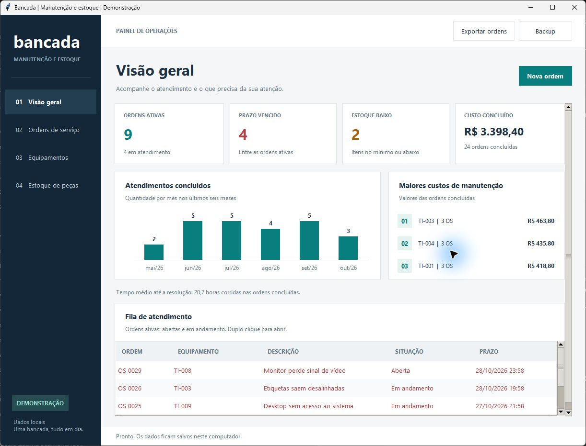

# Bancada

Gestão de manutenção de equipamentos com Python, SQLite e interface desktop. O projeto acompanha o atendimento desde a abertura da ordem até a resolução, incluindo peças utilizadas, movimentação de estoque e custos.



## O que dá para fazer

- Cadastrar equipamentos, técnicos e peças.
- Abrir ordens com prioridade e prazo de atendimento.
- Iniciar, anotar, concluir ou cancelar uma ordem.
- Registrar consumo e devolução de peças com atualização do estoque.
- Consultar indicadores, custos e histórico de cada atendimento.
- Exportar ordens para CSV e criar uma cópia consistente do banco.

O SQL está no modelo relacional, nas consultas de análise e nas operações da aplicação. O consumo de uma peça, a atualização do estoque e o registro no histórico fazem parte da mesma transação.

## Executar

Requisitos: Python 3.11 ou superior, com Tkinter. No Windows, a instalação padrão do Python inclui Tkinter e SQLite. Não há pacotes externos para instalar.

Extraia o projeto, abra o terminal nessa pasta e execute:

```powershell
python main.py --demo
```

Isso abre a aplicação com dados fictícios. Na primeira execução são criados 12 equipamentos, 4 técnicos, 8 peças e 35 ordens. A demonstração mantém suas alterações nas próximas aberturas.

Para iniciar com uma base vazia:

```powershell
python main.py
```

No Windows, também é possível usar `executar.cmd` ou `executar.cmd --demo`. As duas bases ficam separadas na pasta `dados`.

## Testes

```powershell
python -m unittest discover -s tests -v
python main.py --demo --check
```

A primeira instrução testa as regras com bases temporárias. A segunda confere a integridade da base de demonstração sem abrir a janela. O [registro de validação](docs/VALIDACAO.md) descreve os ambientes e as verificações executadas.

São 58 testes automatizados. O repositório também inclui um fluxo de GitHub Actions para repeti-los após a publicação.

## Decisões do projeto

- **Dinheiro em centavos:** evita cálculos monetários com ponto flutuante.
- **Custo registrado no consumo:** uma nova compra não altera o custo de ordens antigas.
- **Transações explícitas:** uma falha não deixa estoque e ordem em situações diferentes.
- **Regras fora da interface:** a janela usa a mesma camada de serviço dos testes e da demonstração.
- **Histórico por ordem:** registra abertura, atendimento, peças, notas e encerramento.

## Documentação

- [Primeira execução e exemplo completo](docs/USO.md)
- [Modelo do banco e decisões de implementação](docs/ARQUITETURA.md)
- [Consultas de análise](sql/reports.sql)
- [Roteiro para estudar e modificar](docs/ESTUDO.md)
- [Como publicar no GitHub](docs/PUBLICAR.md)

Esta versão é local, sem login nem sincronização entre computadores. O histórico ajuda a acompanhar as operações, mas não é uma trilha de auditoria inviolável. Não é recomendado guardar dados sensíveis ou usar uma pasta de rede para o banco. Os prazos são contados em horas corridas.
