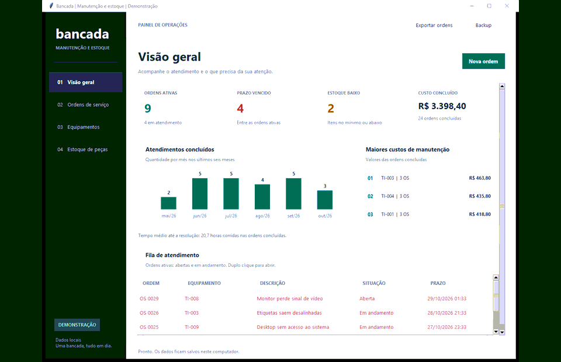
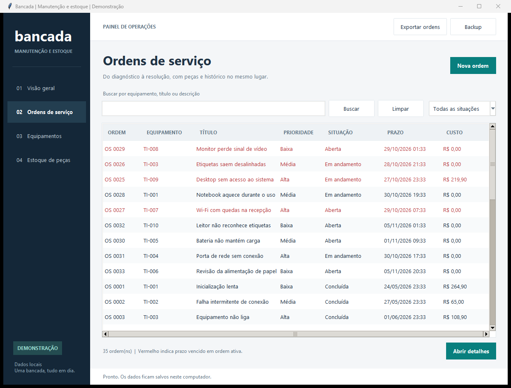
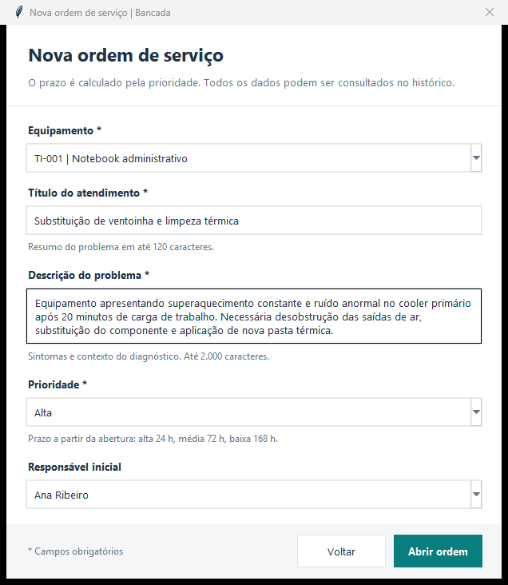
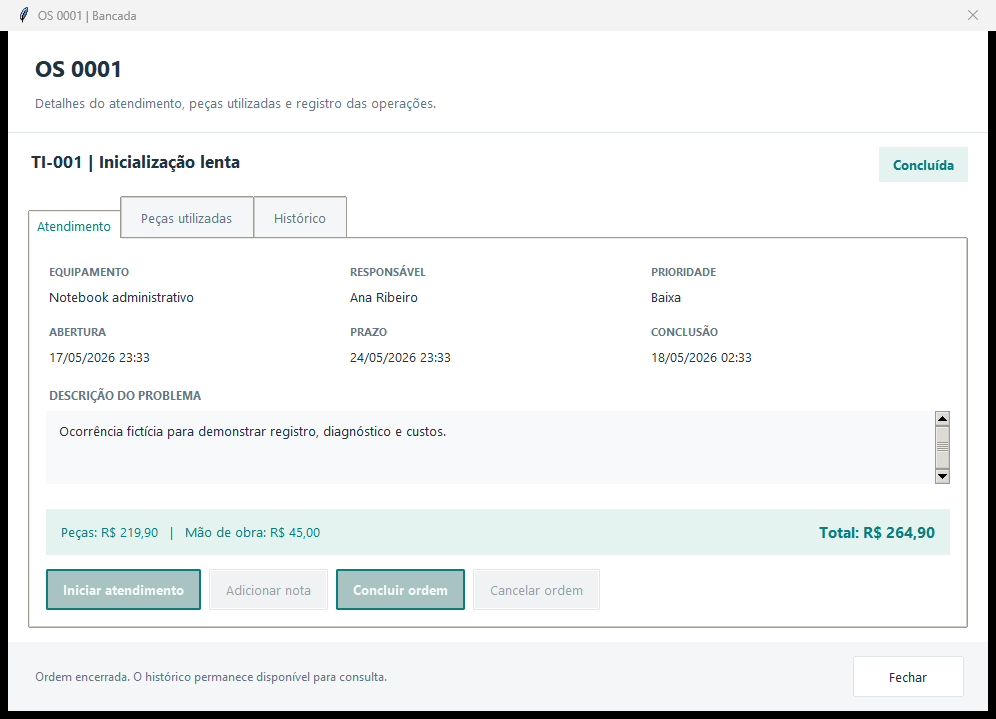
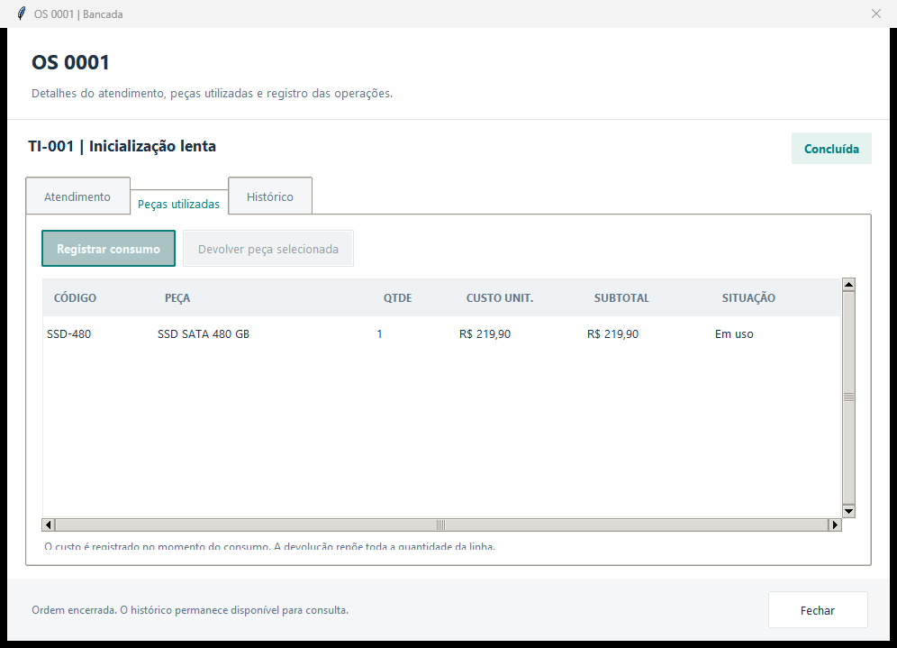
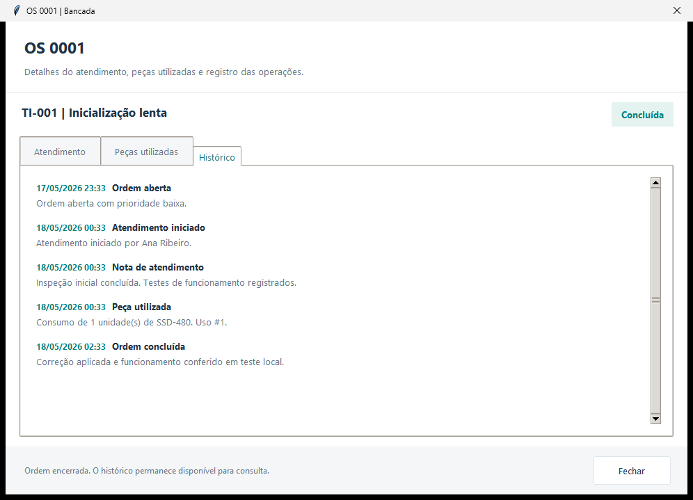
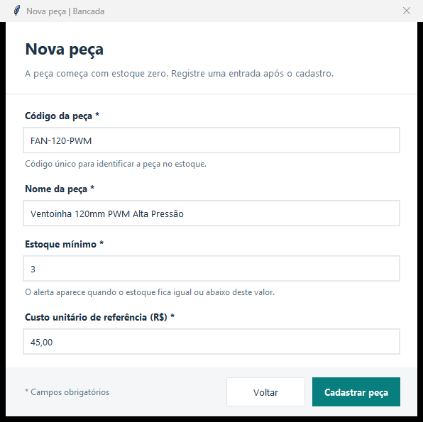
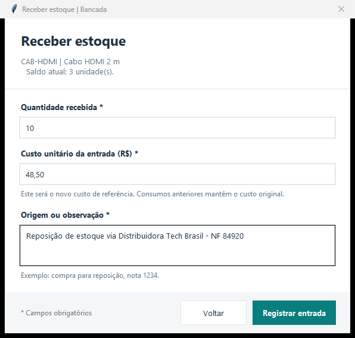
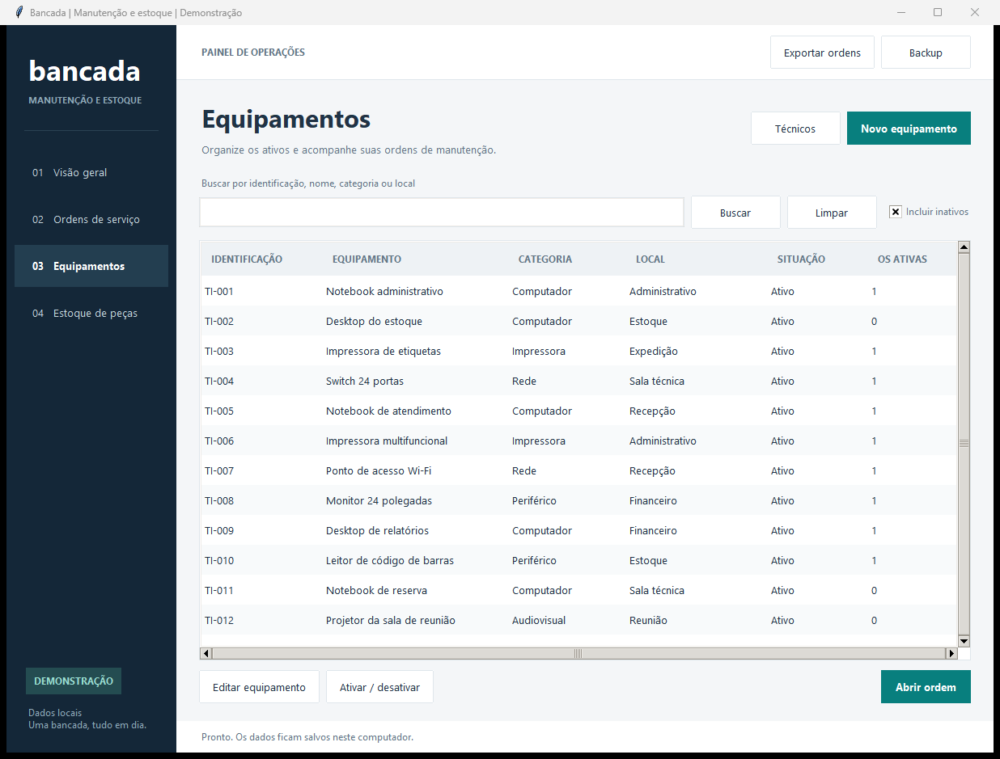
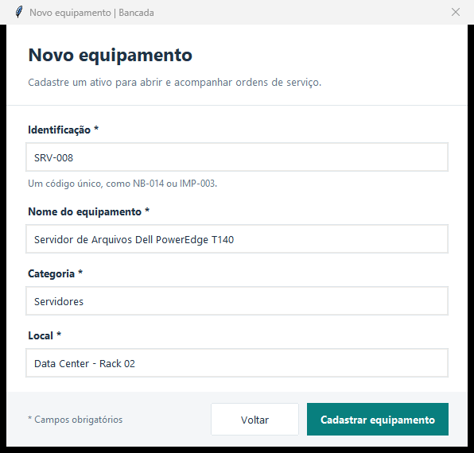

# Bancada

[](https://github.com/LuanVictorz/bancada-python-sql/actions)


Gestão de manutenção de equipamentos com Python, SQLite e interface desktop. O projeto acompanha o ciclo de vida completo do atendimento — desde a abertura do chamado com SLA/prazo dinâmico até a resolução —, incluindo consumo e devolução de peças, histórico de auditoria e cálculo de custos.



---

## Demonstração das Funcionalidades

### 1. Gestão de Ordens de Serviço (OS)

O fluxo de ordens de serviço centraliza o diagnóstico, prazos e custos:

* **Fila de Atendimento e Filtros:** Lista todas as ordens com status (*Aberta*, *Em andamento*, *Concluída*, *Cancelada*), prioridade (*Alta*, *Média*, *Baixa*) e destaque em vermelho para chamados com prazo vencido.
* **Criação de Novas Ordens:** O prazo de conclusão é calculado automaticamente de acordo com o nível de prioridade (Alta: 24h, Média: 72h, Baixa: 168h). É possível vincular o equipamento e o responsável técnico na abertura.





#### Detalhes do Atendimento, Peças e Histórico:
Ao abrir qualquer ordem, uma janela modal fornece visão em três abas completas:
1. **Atendimento:** Informações do ativo, técnico responsável, datas, notas operacionais e botões para transição de status (*Iniciar atendimento*, *Adicionar nota*, *Concluir*, *Cancelar*).
2. **Peças Utilizadas:** Registro de peças consumidas no atendimento. O sistema debita o saldo do estoque e recalcula instantaneamente o custo total da OS. Caso uma peça não seja usada, o botão *Devolver peça* restaura o saldo e abate o valor da ordem.
3. **Histórico:** Trilha de eventos imutável registrando cada ação, troca de status e movimentação com data/hora.







---

### 2. Controle de Estoque de Peças

Controle de estoque relacional integrado diretamente com as ordens de manutenção:

* **Alertas Visuais:** Indicação automática de *Repor estoque* em vermelho quando o saldo físico atinge ou fica abaixo do estoque mínimo definido.
* **Cadastro de Peças:** Código SKU único, descrição, nível de estoque mínimo para disparo de alertas e custo unitário de referência.
* **Receber Estoque:** Registro de entradas de reposição com quantidade, custo unitário atualizado e anotação de origem (nota fiscal ou fornecedor).






---

### 3. Gestão de Equipamentos e Ativos

Mapeamento do parque de equipamentos atendidos pela bancada:

* **Identificação Única:** Código de patrimônio/tag (ex: `NB-014`, `SRV-008`), nome, categoria e localização física (setor, sala ou rack).
* **Controle de Disponibilidade:** Ativos inativos não podem receber novas ordens de serviço. Equipamentos com ordens em aberto não podem ser desativados acidentalmente.
* **Acesso Rápido:** Botão direto para disparar uma nova ordem a partir do equipamento selecionado.





---

### 4. Painel de Indicadores e Relatórios (Visão Geral)

* **Cartões de Métricas:** Contagem de ordens ativas, chamados em atraso, itens em estoque crítico e custo total acumulado de ordens concluídas.
* **Gráficos e Ranking:** Evolução mensal de atendimentos nos últimos seis meses e ranking dos equipamentos com maior custo de manutenção.
* **Exportação e Backup:** Exportação de todas as ordens para arquivo `.csv` formatado e criação de cópia consistente do banco SQLite (`.sqlite3`) sem interromper a operação.


---

## Como Executar

### Pré-requisitos
* **Python 3.11 ou superior** com suporte a Tkinter (incluso por padrão na instalação oficial do Python para Windows).
* Não há dependências externas nem necessidade de criar ambientes virtuais com `pip`.

### Executando com Dados de Demonstração
Para explorar o sistema com uma base de teste completa (12 equipamentos, 4 técnicos, 8 peças e 35 ordens pré-cadastradas):

```powershell
python main.py --demo
```

### Executando em Modo Produção (Base Vazia)
Para começar a cadastrar seus próprios dados a partir do zero:

```powershell
python main.py
```

*Nota no Windows:* É possível utilizar os atalhos `executar.cmd` ou `executar.cmd --demo`. Os arquivos do banco de dados ficam salvos de forma isolada no diretório `dados/`.

---

## Testes Automatizados

O projeto possui **58 testes automatizados** cobrindo integridade de banco de dados, transações atômicas, cálculos financeiros e regras de negócio da interface.

Para rodar a suíte completa de testes no terminal:

```powershell
python -m unittest discover -s tests -v
```

Para validar a integridade da base de dados sem abrir a janela:

```powershell
python main.py --demo --check
```

*(O repositório inclui um pipeline no GitHub Actions que executa automaticamente todos os testes em ambientes Ubuntu e Windows para as versões 3.11, 3.12 e 3.14 do Python).*

---

## Decisões Técnicas e Arquitetura

* **Dinheiro em Centavos:** Todos os valores monetários são representados como números inteiros em centavos no SQLite e nos cálculos, eliminando imprecisões de arredondamento inerentes a números de ponto flutuante (*floating point*).
* **Histórico de Custo no Consumo:** Ao consumir uma peça em uma OS, o custo unitário vigente no momento é gravado de forma imutável na transação. Compras futuras com valores diferentes não distorcem o custo real de ordens já fechadas.
* **Transações Atômicas (ACID):** O consumo de uma peça, a baixa no estoque e o registro do evento no histórico são executados sob a mesma transação com `BEGIN IMMEDIATE`. Caso ocorra qualquer falha, o sistema executa *rollback* automático.
* **Camada de Serviço Desacoplada:** Toda a regra de negócio reside na camada `Service` (`app/service.py`), permitindo que a interface gráfica e a suíte de testes consumam exatamente os mesmos métodos.
* **Rastreabilidade Total:** A tabela `os_historico` armazena cada mudança de status, anotação técnica e movimentação com data/hora.

---

## Documentação Complementar

* [Guia de Uso Passo a Passo](docs/USO.md)
* [Arquitetura e Modelo Entidade-Relacionamento](docs/ARQUITETURA.md)
* [Consultas Analíticas em SQL](sql/reports.sql)
* [Roteiro de Estudos e Modificações](docs/ESTUDO.md)
* [Validação e Cobertura dos Ambientes](docs/VALIDACAO.md)
