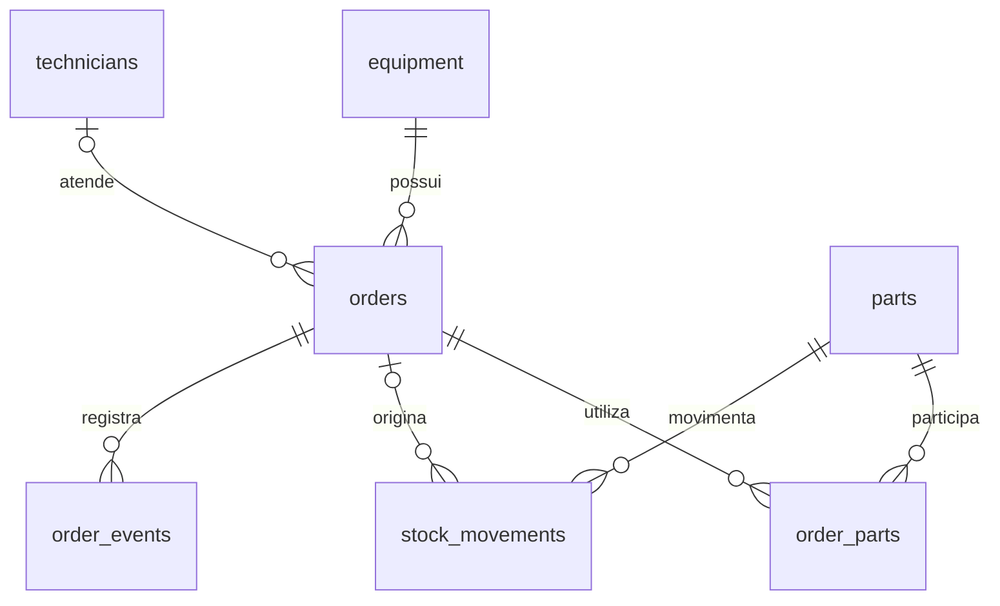

# Organização e banco de dados

## Caminho de uma operação

`main.py` escolhe a base, inicializa a estrutura e abre a aplicação. `app/ui.py` recebe entradas e mostra respostas. `app/service.py` valida as regras e executa as operações. `app/db.py` cria conexões e cuida da versão da estrutura.

O arquivo `app/demo.py` cria os exemplos usando os mesmos serviços. A carga ocorre em uma base temporária e só vira a demonstração quando foi concluída. Abrir novamente não recarrega nem apaga os registros.

## Relações

| Tabela | Responsabilidade |
| --- | --- |
| `equipment` | Patrimônio, nome, categoria, local e situação do equipamento |
| `technicians` | Técnicos disponíveis para assumir atendimentos |
| `parts` | Peças, saldo, mínimo e custo de referência |
| `orders` | Problema, prioridade, técnico, datas, situação, solução e mão de obra |
| `order_parts` | Consumo de cada peça, quantidade, custo registrado e devolução |
| `stock_movements` | Entradas, consumos e devoluções do estoque |
| `order_events` | Histórico das operações de uma ordem |

O SQL de criação está em `sql/001_schema.sql`. As consultas de leitura para estudo estão em `sql/reports.sql`. O serviço também contém SQL parametrizado para os fluxos da aplicação.

## Consumo de peças

O consumo precisa atualizar quatro informações em conjunto: saldo da peça, vínculo com a ordem, movimento de estoque e evento no histórico.

O serviço abre uma transação de escrita, confere a ordem e o saldo, realiza as alterações e confirma. Se alguma instrução falhar, tudo volta à situação anterior. A transação começa com `BEGIN IMMEDIATE`, para que duas conexões não aprovem o mesmo saldo antes de escrever.

Chaves estrangeiras ficam habilitadas em cada conexão. As restrições do banco complementam as validações do serviço. Instruções parametrizadas mantêm as entradas do usuário separadas do texto SQL.

## Custos e consultas

Custos ficam em centavos inteiros. A interface converte o texto monetário usando `Decimal`. O total de uma ordem é a mão de obra mais a soma das peças não devolvidas, com os preços registrados na hora do consumo.

Relatórios precisam agregar os consumos antes de combiná-los com as ordens. Juntar diretamente ordens e várias peças e depois somar a mão de obra contaria o mesmo serviço mais de uma vez. Os testes incluem ordens com várias peças para verificar esse caso.

Os indicadores de custo encerrado consideram apenas ordens concluídas. O custo de uma ordem em andamento pode ser consultado no detalhe, mas ainda não entra no total das concluídas.

## Datas, versão e recuperação

Datas são gravadas em ISO 8601 com fuso UTC. O serviço aceita um relógio substituível, permitindo testes com datas previsíveis e criação da demonstração sem mudar o relógio do computador.

`PRAGMA user_version` identifica a versão da estrutura. Uma base já inicializada é preservada. Uma versão futura é recusada, para evitar abrir dados incompatíveis com um programa antigo. Não há migração de versão anterior nesta primeira versão.

O backup usa `Connection.backup`, seguido de verificações de integridade e relacionamentos. Copiar apenas o arquivo principal durante uma gravação não é o procedimento de backup recomendado.

## Limites deliberados

Não há ORM, servidor HTTP nem dependências externas. Isso deixa as consultas e as transações visíveis para estudo. O histórico é registrado na mesma transação da operação, mas alguém com acesso direto ao banco pode alterá-lo. A aplicação não oferece controle de identidade ou auditoria de segurança.

Referências técnicas: [sqlite3 no Python](https://docs.python.org/3/library/sqlite3.html), [transações no SQLite](https://www.sqlite.org/lang_transaction.html) e [chaves estrangeiras](https://www.sqlite.org/foreignkeys.html).
