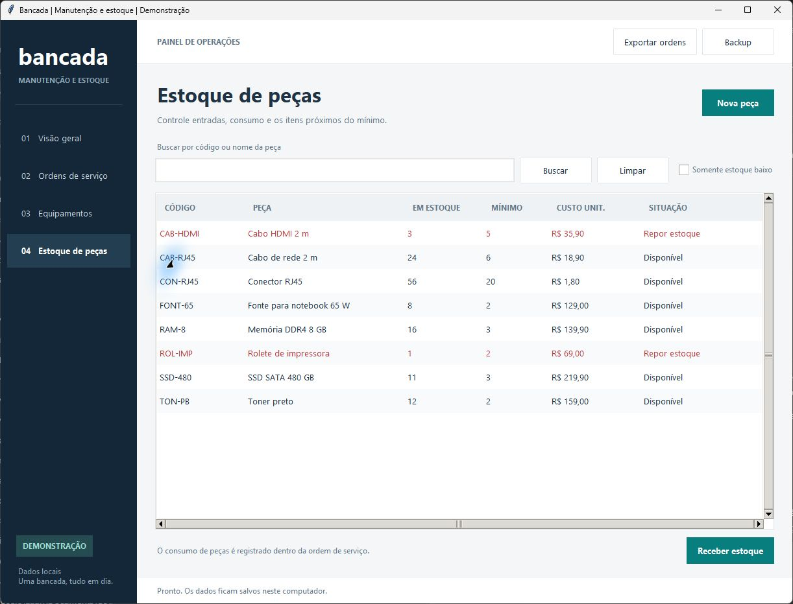

# Validação da versão 1.0

Verificações realizadas em 29/10/2026. Os registros utilizados nos testes e nas capturas são fictícios.

## Testes automatizados locais

Comando: `python -m unittest discover -s tests -q`.

| Ambiente | Testes | Falhas | Erros | Ignorados |
| --- | ---: | ---: | ---: | ---: |
| Windows, Python 3.15.1 | 58 | 0 | 0 | 0 |
| Windows, Python 3.12.14 | 58 | 0 | 0 | 0 |

As execuções terminaram com código zero. Os testes usam bases temporárias próprias e não dependem da base de demonstração nem dos dados normais da aplicação.

## Cenários verificados

- Cadastro, edição, desativação e pesquisa de equipamentos.
- Chaves estrangeiras, restrições do banco, inicialização repetida e rejeição de versão futura.
- Transições de ordens, prazos com relógio fixo, datas e rejeição de mudanças em estados encerrados.
- Saldo insuficiente, devolução duplicada e cancelamento com peças ainda em uso.
- Duas instâncias disputando a última unidade disponível.
- Rollback de consumo quando ocorre falha na gravação do movimento ou do evento.
- Custo histórico preservado após uma nova entrada com preço diferente.
- Indicadores sem duplicar mão de obra quando uma ordem tem várias peças.
- Exportação com BOM e proteção de textos que poderiam virar fórmulas em planilhas.
- Backup reaberto, integridade e recusa de sobrescrever arquivos existentes.
- Demonstração com 35 ordens, preservação de edições e ausência de base parcial em caso de falha na carga.
- Conversão e apresentação de valores monetários sem uso de ponto flutuante.

## Interface no Windows

A aplicação foi aberta com a demonstração e suas telas foram conferidas visualmente. O fluxo de consumo e devolução de uma peça foi executado pela janela. As mudanças no saldo, no consumo e no custo foram conferidas também no SQLite.

Durante a revisão foram corrigidos o espaço do painel, o título do ranking de custos e a distribuição do rodapé das janelas de detalhe. As imagens em `docs/imagens` são capturas da aplicação executando, não desenhos de uma interface futura.

## Limites da verificação

Não há afirmação de cobertura total de código, teste de carga, certificação de segurança ou validação de uso em produção. A suíte verifica as regras descritas; nem todas as combinações de interação visual foram automatizadas.

O mínimo declarado é Python 3.11. As versões disponíveis para execução local foram as duas da tabela. O fluxo em `.github/workflows/tests.yml` está configurado para Python 3.11, 3.12 e 3.14 em Windows e Linux; a execução no GitHub ainda depende da publicação. Testes que importam as funções de formulário são ignorados se a distribuição não incluir Tkinter.
